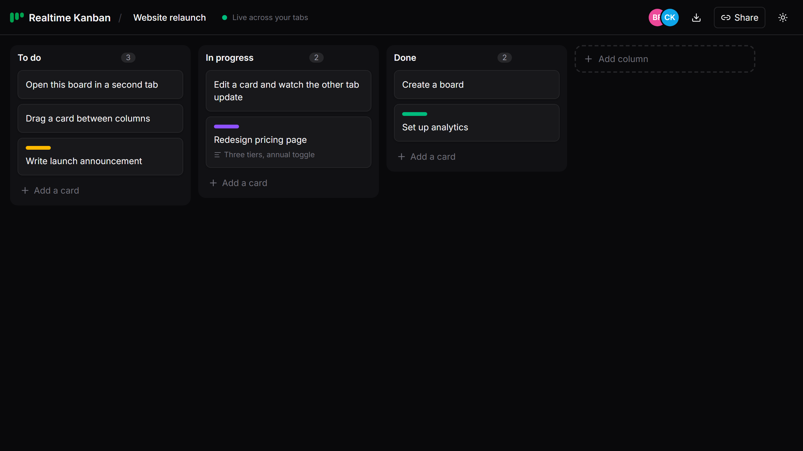

# Realtime Kanban

A Kanban board that stays in sync across tabs and devices, keeps working offline, and never ends up with two copies that disagree.

**Live demo:** https://realtime-kanban-eight.vercel.app. Create a board, open the same link in a second tab, and move a card.



## What you can do

- Create boards and share them by link
- Add, rename, reorder and delete columns
- Add cards, then edit their title, description and color label
- Drag cards with a mouse, press and hold on a touch screen, or use the keyboard (Alt + arrow keys)
- See who else is viewing the board
- Keep editing while offline; changes merge when the connection returns
- Export a board as a Markdown checklist

## How sync works

There is no "current state" that gets sent back and forth. Every change is a small, immutable **operation**, and each copy of the board (a *replica*) builds what you see by applying the operations it has received.

```
 Tab A                          Sync server                         Tab B
 ─────                          ───────────                         ─────
 move card ──▶ op {id, stamp} ──▶ append to SQLite log ──▶ relay ──▶ apply op
                                  (ignores duplicates)               │
 apply op ◀───────────────────────── relay ◀──── op ◀──── rename card
```

Each copy has to end up with the same board, whatever order the operations arrive in. Three rules make that work:

1. **Lamport timestamps.** Every operation carries a counter plus the id of the tab that made it. A replica's counter always jumps past anything it has seen, so a later edit gets a higher stamp. When two stamps are equal, the client id breaks the tie, so every replica orders operations the same way.
2. **Last writer wins, per field.** A card's title, description, label and position are separate registers. If two people edit the title at the same moment, the higher stamp wins everywhere. If one person edits the title while another moves the card, both changes survive.
3. **Deletes are final.** Once a card or column is deleted, a late-arriving edit can't bring it back.

Operations are de-duplicated by id, so sending the same one twice is harmless. That makes reconnecting simple: a client just sends everything it has, and the other side keeps whatever is new.

Card order uses **fractional indexes** (`a0`, `a0V`, `a1`…). Moving a card writes one new position between its neighbours, so a move changes only that card and never renumbers the rest of the column.

These rules are checked by property tests (`src/sync/board.test.ts`). They generate hundreds of random operation histories, shuffle and re-deliver them, and assert that every replica reaches an identical board.

### Two ways to connect

| Mode | When | How |
|---|---|---|
| **Tabs** | Default; used by the live demo | `BroadcastChannel` connects tabs in the same browser. No server needed. |
| **Server** | `VITE_SYNC_URL` is set | A WebSocket server relays operations between browsers and stores them, so late joiners catch up. Clients reconnect with backoff and replay their log on every reconnect. |

Either way, each browser also saves its log in IndexedDB, so boards survive a reload or a crash.

## Run it locally

Requires Node 22.5 or newer (the server uses Node's built-in SQLite).

```bash
npm install
npm run dev          # http://localhost:5173, syncs between tabs
```

To sync between different browsers or machines, start the server and point the app at it:

```bash
npm run server                                   # ws://localhost:8787
VITE_SYNC_URL=ws://localhost:8787 npm run dev
```

Or run the server in Docker, with the log stored in a volume:

```bash
docker build -t realtime-kanban-sync .
docker run -p 8787:8787 -v kanban-data:/data realtime-kanban-sync
```

## Tests

```bash
npm test             # unit, property and server tests (Vitest)
npm run test:e2e     # two-tab browser tests (Playwright)
BASE_URL=https://realtime-kanban-eight.vercel.app npm run test:e2e   # same suite against the live site
```

The end-to-end tests open two tabs of the same board and check that adding, dragging, editing, deleting and renaming in one tab shows up in the other. The server tests use the real browser transport against a server that is stopped mid-session, to check that edits made while offline are delivered once it comes back.

CI runs lint, typecheck, unit tests, the browser tests and a Docker smoke test on every push.

## Project layout

```
src/sync/        Framework-free sync engine: ops, board state, replica, transports, presence
src/state/       Zustand store and IndexedDB persistence
src/components/  React UI (dnd-kit for dragging)
server/          WebSocket relay, SQLite op log, rate limiting
e2e/             Playwright tests
```

`src/sync` has no React imports. The server reuses the same message validation, and the engine could sit behind a different UI.

## Trade-offs

- **The log only grows.** Every operation is kept forever. That suits boards of a few thousand edits; a long-lived production board would need periodic snapshots.
- **Last writer wins on text.** Two people typing in the same description at the same moment won't have their text merged; one version wins. Edits are sent when a field loses focus, which keeps this rare.
- **No accounts.** Anyone with a board's link can edit it, like an unlisted document.

## Built with

React 19, TypeScript, Vite, Tailwind CSS, Zustand, dnd-kit, fractional-indexing, idb-keyval, ws, Node's built-in SQLite, Vitest, fast-check and Playwright.

## License

[MIT](LICENSE)
